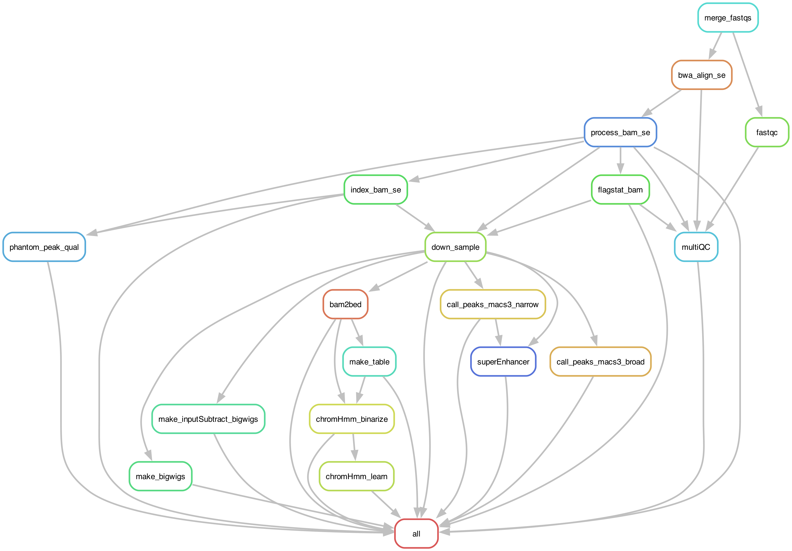

# pyflow-ChIPseq: Modern ChIP-seq Analysis Pipeline

[](https://zenodo.org/badge/latestdoi/89386223)
[](https://snakemake.readthedocs.io)
[](https://www.python.org)
[](LICENSE)

A production-ready Snakemake pipeline for comprehensive ChIP-seq data analysis, from raw FASTQ files to peaks, bigWigs, and super-enhancers.

---

## 📖 Table of Contents

- [Why pyflow-ChIPseq?](#-why-pyflow-chipseq)
- [What Does It Do?](#-what-does-it-do)
- [Pipeline Overview](#-pipeline-overview)
- [How to Use](#-how-to-use)
- [Citation](#-citation)
- [Documentation](#-documentation)
- [Support](#-support)

---

## 🎯 Why pyflow-ChIPseq?

### The Problem

ChIP-seq data analysis requires coordinating dozens of bioinformatics tools with precise parameter settings. Manual analysis is:
- **Error-prone**: Easy to miss steps or use inconsistent parameters
- **Time-consuming**: Repeated copy-pasting of commands for each sample
- **Not reproducible**: Hard to track what was done and share methods
- **Difficult to scale**: Processing 10+ samples manually is tedious

### The Solution

**pyflow-ChIPseq** automates the entire ChIP-seq workflow with:
- ✅ **Reproducibility**: Conda environments ensure identical software versions
- ✅ **Scalability**: Process 1 or 100 samples with the same command
- ✅ **Automation**: One command runs QC → alignment → peaks → visualization
- ✅ **Best practices**: Built-in quality control, duplicate removal, and normalization
- ✅ **Cluster support**: Seamlessly scales from laptops to HPC clusters
- ✅ **Modern tools**: Python 3, MACS3, updated samtools/deepTools

### Who Is It For?

- **Bioinformaticians** processing ChIP-seq data routinely
- **Researchers** who want reproducible analysis without manual steps
- **Core facilities** standardizing ChIP-seq analysis across projects
- **Labs** sharing methods and ensuring consistency

---

## 🔬 What Does It Do?

### Inputs

- **FASTQ files**: Single-end or paired-end ChIP-seq reads
- **Reference genome**: FASTA file (human, mouse, or custom)
- **Metadata**: Simple tab-delimited file describing your samples

### Outputs

| Output | Description | Use Case |
|--------|-------------|----------|
| **Peaks** | Narrow & broad peaks (MACS3) | Identify binding sites, histone marks |
| **BigWigs** | RPKM-normalized & input-subtracted | Genome browser visualization (IGV, UCSC) |
| **BAM files** | Aligned, deduplicated, downsampled | Further custom analysis |
| **QC Reports** | MultiQC summary + phantompeakqual | Assess experiment quality |
| **Super-enhancers** | ROSE2 calls (optional) | Identify regulatory elements |

### Key Features

#### Core Analysis
- **Quality control**: FastQC + MultiQC comprehensive reports
- **Alignment**: BWA mem (long reads) or BWA aln (short reads)
- **Duplicate handling**: Removes PCR duplicates with samblaster
- **Normalization**: Downsampling to target read depth (default 50M)
- **Peak calling**: MACS3 narrow peaks (TFs) and broad peaks (histone marks)
- **Visualization**: RPKM-normalized and input-subtracted bigWigs

#### Advanced Features
- **ChIP quality metrics**: Phantompeakqualtools NSC/RSC scores
- **Super-enhancer calling**: ROSE2 (Python 3 port)
- **Chromatin states**: ChromHMM support (optional)
- **Flexible configuration**: Extensive parameters in config.yaml

#### Technical Excellence
- **Conda integration**: Automatic dependency management
- **SLURM support**: Built-in cluster execution profiles
- **Parallel processing**: Efficiently uses multiple cores
- **Smart caching**: Only reruns changed steps
- **Comprehensive logging**: All commands and outputs tracked

---

## 📊 Pipeline Overview



### Processing Steps

1. **Input Processing**
   - Merge technical replicates
   - Quality control with FastQC

2. **Alignment** (split for debugging)
   - BWA alignment (mem or aln based on read length)
   - Duplicate removal with samblaster
   - BAM sorting and indexing

3. **Quality Assessment**
   - Flagstat metrics
   - Phantompeakqualtools (NSC, RSC, fragment length)
   - MultiQC aggregation

4. **Normalization**
   - Downsample to target read depth
   - Normalize across samples

5. **Peak Calling**
   - MACS3 narrow peaks (q < 0.05)
   - MACS3 broad peaks (q < 0.1)

6. **Visualization**
   - RPKM-normalized bigWigs
   - Input-subtracted bigWigs

7. **Advanced Analysis** (optional)
   - ROSE2 super-enhancers
   - ChromHMM chromatin states

---

## 🚀 How to Use

### Quick Start (5 minutes)

See **[QUICKSTART.md](QUICKSTART.md)** for a complete working example with public data.

```bash
# 1. Clone the repository
git clone https://github.com/crazyhottommy/pyflow-ChIPseq.git
cd pyflow-ChIPseq
git checkout modernize-2025

# 2. Prepare your metadata file
# See QUICKSTART.md for format

# 3. Generate samples.json
python sample2json.py /path/to/fastq/ meta.txt

# 4. Configure pipeline
nano config.yaml  # Edit paths and parameters

# 5. Run!
snakemake --use-conda --cores 8
```

### Full Installation

See **[INSTALL.md](INSTALL.md)** for:
- Installing Snakemake and dependencies
- Setting up reference genomes
- Configuring SLURM clusters
- Troubleshooting common issues

### Configuration

Key settings in `config.yaml`:

```yaml
# Data type
from_fastq: True          # Start from FASTQ (not BAM)
paired_end: False         # Single-end or paired-end
long_reads: True          # >70bp uses bwa mem, <70bp uses bwa aln

# Reference genome
ref_fa: /path/to/genome.fa
macs_g: mm                # mm (mouse) or hs (human)

# Analysis parameters
control: 'Input'          # Control sample name in metadata
downsample: True          # Normalize read depth
target_reads: 50000000    # Target reads after downsampling

# Optional analyses
run_phantompeakqual: True # ChIP quality metrics
chromHMM: False           # Chromatin state modeling
```

### Running on Different Systems

#### Local execution
```bash
snakemake --use-conda --cores 8
```

#### SLURM cluster
```bash
snakemake --profile profiles/slurm
```

#### Dry run (see what will be executed)
```bash
snakemake -n --use-conda
```

### Output Directory Structure

```
pyflow-ChIPseq/
├── 00log/              # All log files
├── 01seq/              # Merged FASTQ files
├── 02fqc/              # FastQC reports
├── 03aln/              # Aligned BAM files
├── 04aln_downsample/   # Downsampled BAMs
├── 05phantompeakqual/  # ChIP quality metrics
├── 06bigwig_inputSubtract/  # Input-subtracted bigWigs
├── 07bigwig/           # RPKM-normalized bigWigs
├── 08peak_macs3/       # Narrow peaks
├── 09peak_macs3/       # Broad peaks
├── 10multiQC/          # Quality summary (START HERE!)
└── 11superEnhancer/    # Super-enhancer calls (optional)
```

**Pro tip**: Start by reviewing `10multiQC/multiQC_log.html` for a comprehensive quality overview!

---

## 📚 Documentation

| Document | Description |
|----------|-------------|
| **[QUICKSTART.md](QUICKSTART.md)** | 5-minute tutorial with example data |
| **[INSTALL.md](INSTALL.md)** | Complete installation guide |
| **[MODERNIZATION.md](MODERNIZATION.md)** | What's new in 2025 version |
| **[CLAUDE.md](CLAUDE.md)** | Repository architecture |
| **[README_original.md](README_original.md)** | Historical documentation |

---

## 📖 Citation

### Pipeline Publication

If you use this pipeline, please cite:

```
Terranova, C., Tang, M., Orouji, E., Maitituoheti, M., Raman, A., Amin, S., et al.
An Integrated Platform for Genome-wide Mapping of Chromatin States Using
High-throughput ChIP-sequencing in Tumor Tissues.
J. Vis. Exp. (134), e56972, doi:10.3791/56972 (2018).
```

**DOI**: [](https://zenodo.org/badge/latestdoi/89386223)

### Key Tools

This pipeline builds on excellent open-source tools:
- **Snakemake**: [Mölder et al., 2021](https://doi.org/10.12688/f1000research.29032.2)
- **MACS3**: [Zhang et al., 2008](https://doi.org/10.1186/gb-2008-9-9-r137)
- **deepTools**: [Ramírez et al., 2016](https://doi.org/10.1093/nar/gkw257)
- **BWA**: [Li & Durbin, 2009](https://doi.org/10.1093/bioinformatics/btp324)
- **samtools**: [Danecek et al., 2021](https://doi.org/10.1093/gigascience/giab008)

---

## 💡 Key Improvements (2025 Modernization)

This branch (`modernize-2025`) represents a complete overhaul:

### Python 3 Migration
- ✅ MACS3 instead of MACS1/MACS2
- ✅ ROSE2 (Python 3 port) for super-enhancers
- ✅ All scripts Python 3 compatible

### Modern Tooling
- ✅ Snakemake v7+ with profiles
- ✅ Conda environments for reproducibility
- ✅ Updated tools: samtools 1.19+, deepTools 3.5+

### Better UX
- ✅ Simplified configuration
- ✅ Better error messages
- ✅ Comprehensive documentation
- ✅ Split alignment steps for easier debugging

### Performance
- ✅ Parallel execution optimized
- ✅ Smart temp file cleanup
- ✅ Configurable threading

See **[MODERNIZATION.md](MODERNIZATION.md)** for complete details.

---

## 🛠️ Troubleshooting

### Common Issues

| Problem | Solution |
|---------|----------|
| `samples.json not found` | Run `python sample2json.py /path/to/fastq meta.txt` |
| Reference genome not indexed | Run `bwa index genome.fa` |
| Memory errors | Increase `mem_mb` in Snakefile resources |
| Conda is slow | Use `--conda-frontend mamba` |
| ROSE2 fails | Check genome name is uppercase: HG38, MM10 |

See **[INSTALL.md](INSTALL.md)** for detailed troubleshooting.

---

## 🤝 Support

- **Issues**: [GitHub Issues](https://github.com/crazyhottommy/pyflow-ChIPseq/issues)
- **Snakemake docs**: https://snakemake.readthedocs.io/
- **Email**: Contact the author through GitHub

---

## 📋 Requirements

- **Operating System**: Linux or macOS
- **Memory**: 32 GB RAM minimum (for alignment)
- **Storage**: ~50-100 GB per sample
- **CPU**: Multi-core recommended (8+ cores)

**Software** (auto-installed via conda):
- Python ≥ 3.8
- Snakemake ≥ 7.0
- BWA, samtools, MACS3, deepTools, etc.

---

## 🗺️ Roadmap

Future improvements:
- [ ] Support for additional peak callers (HOMER, SICER)
- [ ] Automatic peak quality filtering
- [ ] Differential binding analysis (DiffBind)
- [ ] Motif enrichment integration
- [ ] Docker/Singularity containers
- [ ] Cloud execution (AWS, Google Cloud)

---

## 📜 License

This project is open source. See repository for license details.

---

## 🙏 Acknowledgments

Originally developed by Ming Tang ([@crazyhottommy](https://github.com/crazyhottommy)) at MD Anderson Cancer Center.

Modernized in 2025 with contributions from the bioinformatics community.

Special thanks to the developers of Snakemake and all the tools integrated in this pipeline.

---

**Ready to analyze your ChIP-seq data?** → Start with **[QUICKSTART.md](QUICKSTART.md)** 🚀
